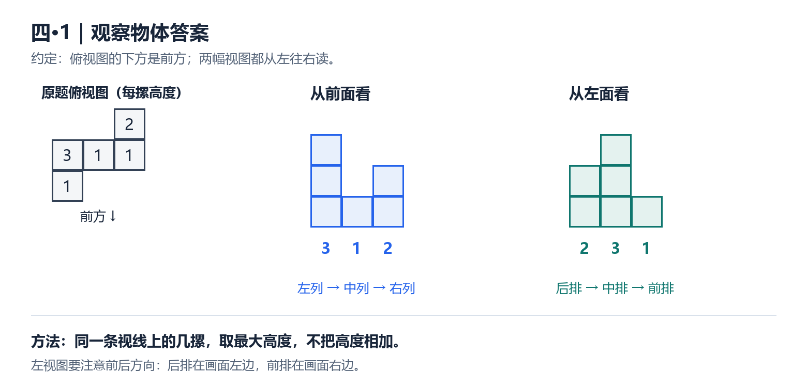
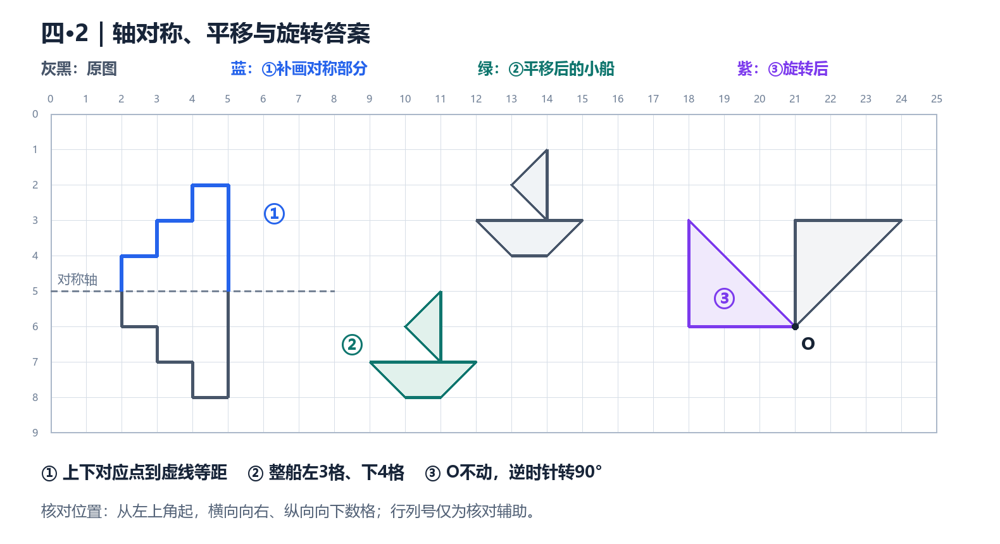

# 试课试卷：答案速查

说明：按《试课试卷.jpg》中可见内容作答。照片从计算题第2题开始，未拍到的题目不在本答案范围内。计算题均按每行从左到右排列。

## 一、计算题第2题：用竖式计算

| 题目 | 答案 |
| --- | --- |
| 0.37×1.35，得数保留两位小数 | **0.50**（准确积为0.4995） |
| 24.3÷0.027 | **900** |
| 1.66÷0.15，商用循环小数表示 | **11.0666…**，只有数字6循环，可写成11.0后面的6上加一点 |

## 二、计算题第3题：能简算的要简算

| 题目 | 答案 |
| --- | --- |
| 13.4×6.3−3.4×6.3 | **63** |
| 0.89×101 | **89.89** |
| 0.175÷0.25×0.4 | **0.28** |
| 5.67×9.9＋0.567 | **56.7** |
| 1.25×3.2×0.25 | **1** |
| 67.2÷（8.6−5.8） | **24** |

## 三、第四大题：按要求完成

### 第1题：观察组合体

以俯视图下方为前方，两幅答案图的各列都从左往右读：

- 从前面看：各列高度依次为 **3、1、2**。
- 从左面看：各列高度依次为 **2、3、1**。

### 第2题：图形运动

- **①轴对称**：沿原图水平虚线补出上半部分；新增的阶梯轮廓见蓝线。
- **②平移**：整条小船先左移3格，再下移4格；结果见绿线。
- **③旋转**：绕O点逆时针旋转90°，O不动，三角形转至O的左上方；结果见紫线。

## 四、第五大题：解决问题

| 题号 | 答案 | 核对算式 |
| --- | --- | --- |
| 1（1）春蚕吐丝的长度 | **1.5 km** | 1.2×1.25＝1.5 |
| 1（2）需要秋蚕的数量 | **大约144条** | 50.4÷0.35＝144 |
| 2 种花草的面积 | **940 m²** | （50−3）×（23−3）＝940 |
| 3（1）最多加工元宵数量 | **147个** | 147×3.4＝499.8，148×3.4＝503.2＞500 |
| 3（1）至少需要袋子数量 | **9个** | 147÷18＝8……3，8＋1＝9 |
| 3（2）寄到山东的邮费 | **39.6元** | 总重8.45 kg；10＋4×3.2＋7×2.4＝39.6 |
| 末题 鲜花饼：阳阳应收回 | **6.15元** | 每人4个；阳阳多付1个的钱，24.6÷4＝6.15 |
| 末题 鲜花饼：光光应收回 | **18.45元** | 光光多付3个的钱，6.15×3＝18.45 |

邮费中的7个计费单位：超过5 kg的部分为8.45−5＝3.45 kg，按3.5 kg收取；3.5÷0.5＝7。前1 kg收费10元，第1 kg至第5 kg的4 kg收费4×3.2元。

## 五、核对时重点检查

1. **0.50末尾的0要保留**，它表示保留到百分位。
2. **11.0666…只循环6**，不是11.060606…。
3. **左视图的前后顺序**：俯视图后方在左视图的左侧，前方在右侧。
4. 元宵用**去尾法**，袋子用**进一法**。
5. 邮费要**分段计算**，且山西寄山东用“省外”一列。
6. 鲜花饼按两人**超过自己应付份额的部分**退款；不能把24.6元按5∶7分。

完整过程、逐题考点、讲解方法和检索来源，见《02_逐题解析与教学方法.md》。
