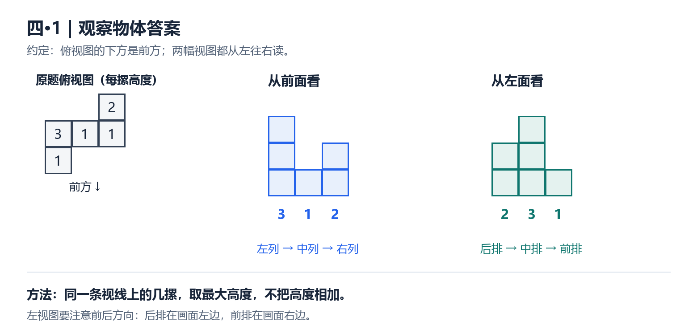
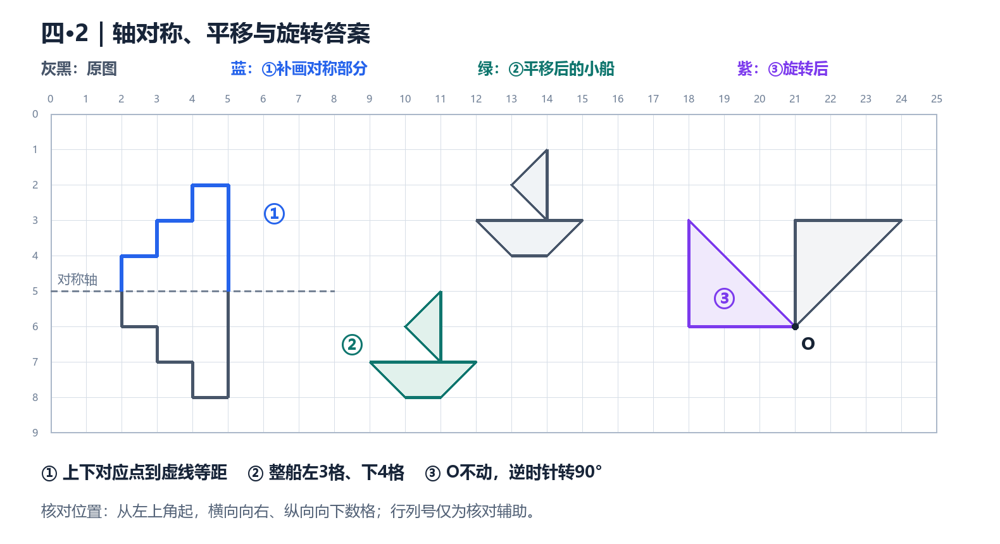
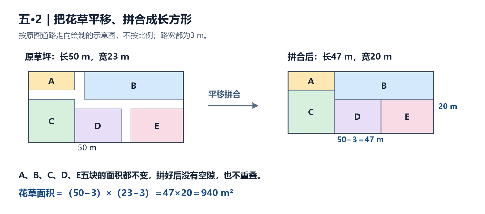

# 试课试卷：逐题解析与教学方法

适用目的：五年级数学家教备课与答案核对。题号按照片可见内容保留；未拍到的题目不补写。本卷同时考查小数计算，以及此前学过的观察物体、图形运动、长方形面积等知识。

## 一、先把方法名称说准确

“运算定律”是知识依据，“凑整、拆数、转化”是选择解法的策略。建议让学生既会说怎么做，也能说出为什么可以这样做。

| 你描述的方法 | 家教中建议使用的名称 | 数学依据及适用结构 | 本卷对应 |
| --- | --- | --- | --- |
| 提公因式 | **逆用乘法分配律（提取相同因数）** | a×c±b×c＝（a±b）×c | 13.4×6.3−3.4×6.3；5.67×9.9＋0.567 |
| 看见99、101就化成100 | **拆数凑整，运用乘法分配律** | 99＝100−1，101＝100＋1；拆开以后每一项都要乘 | 0.89×101 |
| 把容易算的数先乘 | **运用乘法交换律、结合律凑整** | 交换律改变因数顺序；结合律改变先算哪一组 | 1.25×3.2×0.25 |
| 把除以0.25变成乘4 | **转化思想：把除法转化为乘法** | 0.25×4＝1，所以除以0.25相当于乘4 | 0.175÷0.25×0.4 |
| 把小数除法变成整数除法 | **商不变的性质（商不变规律）** | 被除数和除数同时乘或除以同一个不为0的数，商不变 | 24.3÷0.027；67.2÷2.8 |
| 做东西取少一点、装东西取多一点 | **根据实际情况取商的近似值：去尾法与进一法** | 能做几个完整成品要舍去尾数；全部装完，有剩余就多准备一个容器 | 元宵和袋子；邮费的半千克计费单位 |
| 把零散面积挪到一起 | **平移转化法（利用面积不变）** | 平移不改变面积，拼合成便于计算的图形 | 花草面积 |
| 收费先算这一段，再算下一段 | **分段计费** | 各段数量×本段单价，再把费用相加 | 邮费 |
| 大家平分，多付的退回来 | **平均分与差额补偿** | 应收回金额＝已付金额−自己应付金额 | 鲜花饼 |

### 术语检索后的使用建议

- 面向五年级学生，第一类优先说“逆用乘法分配律”或“提取相同的因数”。“提公因式法”通常用于初中整式因式分解；这里用小学已有的运算律更便于解释。
- “拆数凑整”“平移转化”“差额补偿”可作为讲课时的方法提示，并不表示每个教材版本都有一个同名的独立知识点。应同时写明运算定律、图形性质或数量关系。
- 课标明确使用“乘法交换律和结合律、乘法对加法的分配律”等名称；小学教学研究也将运算定律迁移到小数计算。以上策略名称是结合这些依据和本卷题型整理的，不是逐字照搬某一教材的分类。[来源1](https://www.pep.com.cn/xw/zt/rjwy/yjkb2022/202205/P020220512583134605579.pdf)、[来源2](https://tpd.xhedu.sh.cn/cms/app/info/doc/index.php/93492)
- 高校《小学数学解题研究》教案把“凑整”作为速算的重要策略，并列出交换律、结合律、分配律等依据；“进一法、去尾法、四舍五入法”的区别，也可参照一线教师的教学案例。[来源3](https://gk.jyc.edu.cn/__local/4/AA/E1/84C928B96C31AF7ABFAE2B3E19E_D5D82A5D_1EA044.pdf)、[来源4](https://tpd.xhedu.sh.cn/cms/app/info/doc/index.php/92078)

---

## 二、计算题第2题：用竖式计算

### 2（1）0.37×1.35≈？（得数保留两位小数）

**答案：0.50。**

先按整数乘法计算37×135：

```text
    135
×    37
-------
    945
   405
-------
   4995
```

两个因数一共有4位小数，所以准确积是0.4995。保留两位小数，看千分位上的9，向百分位进1，发生连续进位，得到0.50。

- **考点**：小数乘法笔算；积的小数位数；积的近似数；四舍五入法。
- **通用方法**：先按整数乘法求积→确定小数点→看要求保留的数位→观察下一位→四舍五入。
- **易错点**：写成0.49；把保留两位小数的答案写成0.5；把准确积与近似值都用等号连接。
- **讲解切入**：“保留到百分位，要看哪一位？百分位的9再进1，会发生什么？”

### 2（2）24.3÷0.027＝？

**答案：900。**

24.3÷0.027＝24300÷27＝900。

除数有3位小数，为了把除数变成整数，被除数和除数都乘1000。被除数原有小数位数不够，末尾要补0。竖式中243÷27＝9，剩下两个0还要依次处理，商为900。

- **考点**：除数是小数的除法；商不变的性质；商末尾0的占位。
- **通用方法**：看除数有几位小数→两数小数点同时向右移几位→位数不够补0→按整数除法计算。
- **易错点**：只移动除数的小数点；把24300写成2430；商漏写0，得到90或9。
- **验算**：900×0.027＝24.3。除数远小于1，商比24.3大，数量级合理。

### 2（3）1.66÷0.15＝？（商用循环小数表示）

**答案：11.0666…，只有6循环。** 规范简记时，在11.0后面的数字6上加一点。

1.66÷0.15＝166÷15。

166÷15，整数部分是11，余1。继续除：

1. 余数1后补0，10不够除以15，十分位必须商0。
2. 再补0，100÷15商6，余10。
3. 此后每次都是100÷15商6、余10，所以6不断重复。

- **考点**：小数除法；循环小数；循环节的确定与表示；商中间0的占位。
- **通用方法**：不要只看数字“好像在重复”，应观察余数是否重复；同一余数重复出现，后面的商就会重复。
- **易错点**：写成11.666…；把06整体当作循环节，写成11.060606…；把有限小数11.06当作准确商。
- **讲解切入**：“十分位为什么是0？下一步为什么总是回到余数10？”

---

## 三、计算题第3题：能简算的要简算

建议讲解顺序：先看运算符号和结构，再看数的特点，最后选择运算定律。不能只因两个数凑整，就随意改变原式。

### 3（1）13.4×6.3−3.4×6.3

**解答：**

13.4×6.3−3.4×6.3  
＝（13.4−3.4）×6.3  
＝10×6.3  
＝**63**。

- **考点**：乘法分配律的逆运用；小数减法与乘法。
- **方法名称**：逆用乘法分配律，提取相同因数。
- **识别信号**：两个乘积中都有6.3，另两个因数13.4和3.4的差恰好是10。
- **给学生的解释**：“13.4个6.3减去3.4个6.3，还剩10个6.3。”
- **易错点**：写成（13.4−3.4）×（6.3−6.3）。相同的6.3要保留一次。
- **同类迁移**：a×c＋b×c＝（a＋b）×c；减法结构同样适用。

### 3（2）0.89×101

**解答：**

0.89×101  
＝0.89×（100＋1）  
＝0.89×100＋0.89×1  
＝89＋0.89  
＝**89.89**。

- **考点**：乘法分配律的正向运用；小数乘100。
- **方法名称**：拆数凑整，运用乘法分配律。
- **识别信号**：101离100只差1；拆成100＋1以后计算更容易。
- **给学生的解释**：“先算100个0.89，再添上1个0.89。”
- **易错点**：写成89＋1；这是多加了一个1，而原题需要多加一个0.89。
- **同类迁移**：0.89×99＝0.89×（100−1）＝89−0.89＝88.11。看见9.9也可考虑10−0.1，前提是拆后确实更好算。

### 3（3）0.175÷0.25×0.4

**解答：**

0.175÷0.25×0.4  
＝0.7×0.4  
＝**0.28**。

**还可这样理解：**0.25×4＝1，所以除以0.25相当于乘4，原式＝0.175×4×0.4＝0.7×0.4＝0.28。

- **考点**：乘除混合运算顺序；小数乘除法；除法与乘法的转化。
- **方法名称**：同级运算从左到右；也可用“除法转化为乘法”的策略。
- **给学生的解释**：“每份0.25，就是把1分成4份；除以0.25，等于求一共有多少个四分之一。”理解后仍可直接用小数除法计算。
- **易错点**：先算0.25×0.4，变成0.175÷（0.25×0.4），这样结果会变成1.75，已改变原式。乘除同级，不能随意加括号。

### 3（4）5.67×9.9＋0.567

**解答：**

5.67×9.9＋0.567  
＝5.67×9.9＋5.67×0.1  
＝5.67×（9.9＋0.1）  
＝5.67×10  
＝**56.7**。

- **考点**：小数点移动与数的大小变化；构造相同因数；乘法分配律的逆运用。
- **方法名称**：先改写、再提取相同因数凑整。
- **识别信号**：0.567是5.67的0.1倍；9.9恰好差0.1到10。
- **给学生的解释**：“9.9个5.67，再补0.1个5.67，刚好是10个5.67。”
- **易错点**：把0.567写成5.67×1；或者直接写成5.67×（9.9＋0.567）。先找到正确的倍数关系，再逆用分配律。
- **可用的另一解法**：5.67×（10−0.1）＋0.567＝56.7−0.567＋0.567＝56.7。

### 3（5）1.25×3.2×0.25

**五年级的讲解起点：先让学生发现配对关系，再引出拆分。** 不要求先会分数乘除法。

1. 从整数乘法出发：25×4＝100，所以0.25×4＝1；125×4＝500，所以1.25×4＝5。
2. 看见0.25，想到能否从其他因数中拆出4；3.2÷4＝0.8，所以3.2＝4×0.8。
3. 拆开后，原式可以顺次口算：

1.25×3.2×0.25  
＝1.25×（4×0.8）×0.25  
＝5×0.8×0.25  
＝4×0.25  
＝**1**。

**如果已熟悉1.25×0.8＝1，可以用乘法交换律、结合律，把两组数分别配成1：**

1.25×（4×0.8）×0.25  
＝（1.25×0.8）×（4×0.25）  
＝1×1  
＝**1**。

其中1.25×0.8＝1也能从整数乘法推出：125×8＝1000，两个因数共3位小数，得到1.000＝1。无需借助分数乘法。

- **考点**：乘法结合律；乘法交换律；凑整的数之间的关系；等值改写。
- **方法名称**：拆分因数凑整，运用乘法交换律、结合律。
- **识别信号**：先识别0.25×4＝1，再找3.2能否拆成4与另一个数的积。若已熟悉1.25×0.8＝1，再进一步配成两组。
- **给学生的引导问题**：“0.25和几相乘能得到1？3.2里面能不能拆出一个4？另一个因数是多少？拆开后怎样先算更方便？”
- **易错点**：把3.2拆成0.8＋4，或拆后漏掉某个因数。若按原顺序口算1.25×3.2＝4，再乘0.25＝1，也完全正确，不必强求写更长的步骤。
- **分数思想能否用**：0.25＝1/4、1.25＝5/4可以帮助已经理解这些关系的学生观察数的特点；学生若已掌握分数乘除法，用分数计算在数学上也成立。但按人教版六三制的常见编排，系统的分数乘除法安排在六年级上册，五年级上册不应默认学生会用。三年级认识几分之一，也不等于已经学过分数乘除法。[教材编排对照参考：来源6](https://pdf.hanspub.org/AE20210400000_24277017.pdf)
- **说明**：上面直接先算3.2×0.25＝0.8的做法同样正确，但若孩子尚未建立这些数的联系，直接给出这一步不足以教会他如何发现简算机会，应先补上配对关系的探索。

### 3（6）67.2÷（8.6−5.8）

**解答：**

67.2÷（8.6−5.8）  
＝67.2÷2.8  
＝672÷28  
＝**24**。

- **考点**：有括号的混合运算顺序；小数减法；商不变的性质。
- **方法名称**：先算括号，再转化为整数除法。
- **给学生的解释**：“先把一整份有多大算出来，再求67.2里面有多少份。”
- **易错点**：写成67.2÷8.6−67.2÷5.8。一个数除以两个数的差，不能这样拆开。
- **验算**：2.8×24＝67.2。本题按顺序计算已很方便，不必强行套用分配律。

### 简算识别卡

| 先观察什么 | 选择什么方法 | 本卷例子 |
| --- | --- | --- |
| 两个乘积有相同因数 | 逆用乘法分配律 | 第（1）题 |
| 101、99等接近整百的数 | 拆成整百数加减一个数，再分配 | 第（2）题 |
| 一个数像另一个数的10倍、0.1倍 | 先等值改写，构造相同因数 | 第（4）题 |
| 0.25、1.25等，能否配成1或整十数 | 交换、结合，必要时拆分因数 | 第（5）题 |
| 算式含除法或括号 | 先保证运算顺序，再考虑转化 | 第（3）、（6）题 |

---

## 四、第四大题：图形题

### 4—1：由俯视图的数字画从前面、从左面看到的图形

**答案：**从前面看，各列高度为3、1、2；从左面看，各列高度为2、3、1。



俯视图可用下面的高度表整理，空位表示没有小正方体。按通常约定，图的下方是前方。

| 位置 | 左列 | 中列 | 右列 |
| --- | --- | --- | --- |
| 后排 | 空 | 空 | 2 |
| 中排 | 3 | 1 | 1 |
| 前排 | 1 | 空 | 空 |

**从前面看：**沿前后方向观察。

- 左列有高度1、3的两摞，看到的总轮廓高度是3。
- 中列最高1，右列最高2。
- 因此从左往右是3、1、2。

**从左面看：**沿左右方向观察。

- 后排最高2，中排最高3，前排最高1。
- 站在组合体左侧朝右看，后排在画面的左边，前排在画面的右边，所以画成2、3、1。

- **考点**：观察物体；从不同方向辨认形状；俯视图与立体结构的对应；空间观念。
- **通用方法**：先确定观察方向→同一条视线上的几摞只取最大高度→确认从左到右的顺序→画方格轮廓。
- **易错点**：把同一视线上的高度相加；左视图画成1、3、2；认为后面的高方块完全看不到。只要高出前面的遮挡，高出的部分仍能看到。
- **讲解方式**：用8个小积木按高度表搭出来，再让学生把眼睛降到与组合体差不多高的位置，分别从前、从左观察。

### 4—2：轴对称、平移与旋转



图中灰黑色为原图，彩色线为本题需要补画的答案。行列号只用于核对位置，原题没有这些标号。

#### ① 补全轴对称图形

**答案：沿水平虚线，在上方补出与下方阶梯轮廓对称的另一半。**

从虚线上左边的轮廓端点出发，新增部分依次画：**上1格→右1格→上1格→右1格→上1格→右1格→下3格**。

- **考点**：轴对称图形；对称点到对称轴的距离相等。
- **通用方法**：找关键顶点→数它到对称轴的格数→在轴另一侧同一直线上取等距离的点→按原来的顺序连线。
- **本题核对**：对称轴是核对图中标为5的水平网格线（距顶边5格）；最下方顶点距轴3格，补画的最上方对应点也应距轴3格。
- **易错点**：把对称当成把原图整体往上搬；只顾外形相似，却没有逐点检查到轴的距离；把轴上的点也移动。

#### ② 小船先左移3格，再下移4格

**答案：整条小船的每个顶点都左移3格、下移4格，大小和朝向保持一致。**

例如，原帆顶点位于核对图的（14，1），平移后是（11，5）。这里的数表示“从左上角往右、往下数的格数”，不是课堂上必须引入的新坐标规定。

- **考点**：平移的方向和距离；平移后形状、大小不变。
- **通用方法**：选择帆顶、船头、船尾等关键点→每个点按同样方向移动同样格数→连成完整小船。
- **易错点**：把两次平移合成“沿斜线数5格”；只移动船身，忘记帆；移动后把船翻了方向。可以连接起点终点看出位移，但落点仍要按左3、下4确定。

#### ③ 三角形绕O点逆时针旋转90°

**答案：O保持不动，三角形旋转到O的左上方。**

原来另外两个顶点相对于O的位置分别是：

- 正上方3格 → 旋转后在O正左方3格。
- 右3格、上3格 → 旋转后在O左3格、上3格。

将这两个新点与O连接，就是答案；新直角顶点在O正左方3格处。

- **考点**：旋转三要素——旋转中心、方向、角度；对应点到旋转中心距离不变。
- **通用方法**：固定中心→确认逆时针方向→把中心到各顶点的线段转过90°→保持长度→连接新顶点。
- **易错点**：绕三角形自己的直角顶点旋转；画到O的右下方；只移动顶点却没有改变边的方向。
- **讲解方式**：把三角形描在透明纸上，以笔尖固定O，实际逆时针转四分之一圈，再与方格答案核对。

---

## 五、第五大题：解决问题

### 5—1（1）：春蚕吐丝的长度

**解答：**1.2×1.25＝**1.5（km）**。

答：一条春蚕吐出的丝长约1.5 km。

- **考点**：小数倍数关系；求一个数的几倍；小数乘法。
- **数量关系**：春蚕吐丝长度＝秋蚕吐丝长度×1.25。
- **方法**：圈出比较标准“秋蚕”，再判断所求是标准量的1.25倍，用乘法。
- **易错点**：把1.25倍理解成“再增加1.25倍”；用1.2÷1.25；误把质量0.35 g代入长度计算。
- **讲解切入**：“春蚕的丝更长，所以结果应比1.2大；1.25倍就是原来的1倍，再加原来的0.25倍。”

### 5—1（2）：制作一件衣服需要多少条秋蚕的吐丝量

**解答：**50.4÷0.35＝**144（条）**。

答：大约需要消耗144条秋蚕的吐丝量。

- **考点**：小数除法的意义；总量与每份量；筛选有效信息。
- **数量关系**：秋蚕条数＝所需丝的总质量÷每条秋蚕吐丝的质量。
- **方法**：统一使用g作单位，取50.4 g和0.35 g进行比较。题目中衣服的49 g是背景信息，本问需要的是明确给出的50.4 g原料。
- **易错点**：用49÷0.35；用长度1.2 km去除质量50.4 g；拿第（1）问的1.5代替每条秋蚕吐丝质量。
- **讲解切入**：“我们现在求的是做衣服的原料用量，还是成品衣服的质量？每条秋蚕能提供多少克？”

### 5—2：长方形草坪中的小路与花草面积

**解答：**把花草部分平移、拼合，等效为长50−3＝47 m、宽23−3＝20 m的长方形。



图中把下方左侧花草再分成C、D两块；同色块保持原来的形状和大小，只做平移。合拢后水平方向减少一条3 m宽的小路，竖直方向也减少一条3 m宽的小路。

（50−3）×（23−3）  
＝47×20  
＝**940（m²）**。

答：种花草的面积是940 m²。

**另一种核对方法：**先将弯折、错开的道路等效转化成一横一竖的道路，路的总面积为50×3＋23×3−3×3＝210 m²。草坪总面积50×23＝1150 m²，1150−210＝940 m²。

- **考点**：长方形面积；组合图形面积；图形平移；面积不变与转化思想。
- **方法名称**：平移转化法；也可先转化道路，再用“总面积减去道路面积”。
- **通用方法**：观察路宽是否一致、路是否贯穿→尝试把错开的部分平移→看能否拼成规则图形→确定新图形的长和宽。
- **易错点**：长、宽各减两次3；把路的重叠区域重复扣除；不做图形分析就对任何有路的草坪套（长−路宽）×（宽−路宽）。本题能这样计算，取决于图中道路的具体走向和统一的3 m宽度。
- **讲解切入**：“如果把隔着小路的花草挪到一起，面积会改变吗？长的方向总共少了多少，宽的方向总共少了多少？”

### 5—3（1）第一问：500 g原料最多加工多少个元宵

**解答：**500÷3.4＝147.058823…，只能加工**147个**完整元宵。

用乘法验证更直接：

- 147×3.4＝499.8（g），原料够用。
- 148×3.4＝503.2（g），超过500 g，原料不够。

- **考点**：小数除法应用；根据实际情况取商的近似值。
- **方法名称**：去尾法。
- **数量关系**：能加工的完整个数＝总原料质量÷每个的原料质量所得商的整数部分。
- **易错点**：看到还有余数就进成148；把不足一个的原料也算成一个成品。
- **讲解切入**：“剩下0.2 g，够不够再做一个需要3.4 g的元宵？”

### 5—3（1）第二问：每18个一袋，至少需要多少个袋子

**解答：**147÷18＝8（袋）……3（个）。8袋装完后还剩3个，还需要1个袋子。

8＋1＝**9（个）**。

- **考点**：有余数的除法；根据实际情况取商的近似值。
- **方法名称**：进一法。
- **数量关系**：有剩余时，袋子数＝整袋数＋1。
- **易错点**：按四舍五入把8.1666…取成8；第二步仍沿用上一问的去尾法；把500 g直接除以18个，单位不匹配。
- **讲解切入**：“8个袋子只能装144个，剩下3个要不要也装完？”

**两问对照：**制作成品受“够不够做一个”限制；准备容器受“能不能全部装完”限制。不能只看“最多”“至少”两个词就机械选择，最终要回到情境判断。若正好整除，进一法也不额外加1。[取值方法的教学参考：来源4](https://tpd.xhedu.sh.cn/cms/app/info/doc/index.php/92078)

### 5—3（2）：13盒元宵寄到山东，邮费多少元

**第一步：求总质量并换算单位。**

13×650＝8450（g）＝8.45（kg）。

山西寄到山东，应使用**省外**收费标准。按题中13盒合为一个包裹寄送计算，题目未另给外包装质量。

**第二步：分三段算费用。**

| 重量范围 | 本次计费数量 | 省外收费 | 本段费用 |
| --- | --- | --- | --- |
| 首重1 kg | 1个首重 | 10元 | 10元 |
| 超过1 kg但不超过5 kg的部分 | 5−1＝4 kg | 每1 kg，3.2元 | 4×3.2＝12.8元 |
| 超过5 kg的部分 | 8.45−5＝3.45 kg，按3.5 kg计，共7个0.5 kg | 每0.5 kg，2.4元 | 7×2.4＝16.8元 |

**第三步：相加。**

10＋12.8＋16.8＝**39.6（元）**。

答：需付邮费39.6元。

- **考点**：质量单位换算；读表；分段计费；小数乘加；不足一个计费单位时的进一处理。
- **方法名称**：分段计费，结合单位换算和进一法。
- **通用方法**：先确定省内/省外→求总重并统一单位→按收费边界分段→计算各段计费数量→各段费用相加。
- **易错点**：把8.45 kg全部按最高一档计费；第2段算成5 kg而不是4 kg；将3.45÷0.5＝6.9按四舍五入理解，而忘记题目规定不足0.5 kg按0.5 kg算；把650 g写成6.5 kg。
- **讲解切入**：“已经超过5 kg，前5 kg还要不要按前面的价格付？超过5 kg的是多少？最后0.45 kg要算几个半千克？”

### 5—末题：鲜花饼公平分账

题目信息：3人平均吃12个；阳阳先付5个的钱，光光先付7个的钱；乐乐应补付24.6元。求阳阳、光光各应收回多少。

**第一步：求每人应承担几个饼的钱。**

12÷3＝4（个）。

**第二步：求每个饼的单价。**

乐乐的24.6元，就是他自己那4个饼的钱：24.6÷4＝6.15（元）。

**第三步：各自按“多付的部分”收回。**

- 阳阳多付5−4＝1个饼的钱，应收回1×6.15＝**6.15元**。
- 光光多付7−4＝3个饼的钱，应收回3×6.15＝**18.45元**。

**检验：**

- 两人合计收回6.15＋18.45＝24.6元，正好等于乐乐补付的钱。
- 阳阳最终支出5×6.15−6.15＝24.6元。
- 光光最终支出7×6.15−18.45＝24.6元。
- 乐乐支出24.6元，三人最终支出相同。

- **考点**：平均分；单价、数量、总价关系；先付款与应付款的区分；多步应用题。
- **方法名称**：先求平均份额，再求差额；可概括为平均分与差额补偿。
- **通用方法**：算每人应承担多少→算单价或每份金额→用已承担数量减应承担数量→把多出的数量换成钱。
- **易错点**：把24.6元按5∶7分给两人；用7−5＝2去除24.6。5和7是已付数量，包含两人各自应该承担的4个饼；补偿的对象是各自多付的1个、3个。
- **讲解切入**：“他们先把自己吃的4个饼的钱留下，阳阳还替别人付了几个？光光还替别人付了几个？”

---

## 六、这张卷子可以归纳出的教学主线

| 主线 | 本卷题目 | 学生需要真正说清楚的内容 |
| --- | --- | --- |
| 小数计算的准确性 | 竖式3题、混合运算 | 小数点为什么放在这里；0为什么不能漏；结果是准确值还是近似值 |
| 有依据的简便计算 | 简算6题 | 看到了什么结构；用了哪条运算定律；改写前后为什么相等 |
| 从空间到平面、从原图到新图 | 观察物体、轴对称、平移、旋转 | 从哪看；哪些点动、怎样动；哪些性质保持不变 |
| 从情境抽取数量关系 | 蚕丝、元宵、邮费、鲜花饼 | 哪些数据有用；每步算的是什么；单位是否一致；结果是否符合实际 |

讲解每道错题时，可以固定追问三句话：**“你这一步求的是什么？”“为什么可以这样算？”“把答案放回原题，是否说得通？”** 不必让学生记住所有策略标签，重点是能识别结构、说明依据并迁移到同类题。

## 七、检索来源

以下资料用于核对术语与教学表达。本卷具体数值答案、画图和逐题归纳为独立解答。

1. [教育部《义务教育数学课程标准（2022年版）》：人民教育出版社公开版本](https://www.pep.com.cn/xw/zt/rjwy/yjkb2022/202205/P020220512583134605579.pdf)。用于核对运算律、数量关系、图形学习领域的表述。
2. [徐汇教师网：虞莹《基于“思维可视化”策略的数学教学案例开发》](https://tpd.xhedu.sh.cn/cms/app/info/doc/index.php/93492)。含运算定律的归纳、用于简算，以及整数运算定律向小数迁移的教学讨论。
3. [揭阳职业技术学院：《小学数学解题研究》教案](https://gk.jyc.edu.cn/__local/4/AA/E1/84C928B96C31AF7ABFAE2B3E19E_D5D82A5D_1EA044.pdf)。其“乘法凑整”等内容列出运算定律作为依据；本次检索可读到索引摘录，原PDF直接加载超时。
4. [徐汇教师网：樊荟《基于核心素养，重塑学习路径——〈大数与凑整〉案例分析》](https://tpd.xhedu.sh.cn/cms/app/info/doc/index.php/92078)。用于核对进一法、去尾法、四舍五入法及情境判断的教学表达。
5. [上海市徐汇区日晖新村小学：《自主学习培养学习能力》](https://rxxx.xhedu.sh.cn/cms/app/info/doc/index.php/25543)。以小数混合运算说明：使用分配律必须检查相同因数，不能只凭数字随意凑整。
6. [汤珍、陈林：《对分数运算及其相关内容的认识和思考——以人教版与北师版教材对比为例》](https://pdf.hanspub.org/AE20210400000_24277017.pdf)，2021年，表1。其对2014年审定人教版教材的分析列明：五年级下册为分数的意义和性质、分数加减法，六年级上册为分数乘除法；用于说明分数认识与分数乘除法的进度区别。
