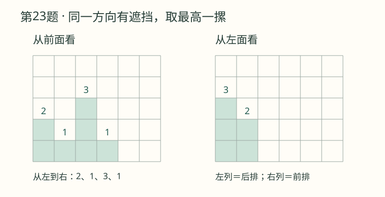
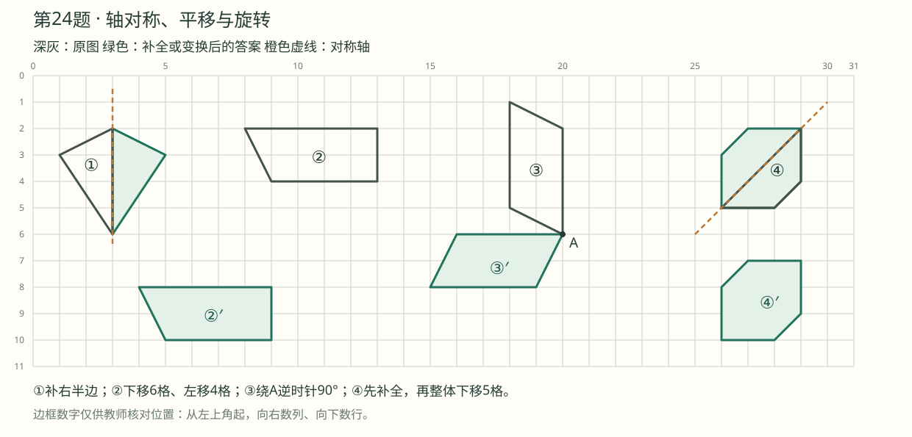

# 第一阶段适应性活动1109：答案速查

对应原卷《26-27学年度五上数学第一阶段适应性活动1109》，共2页、29题。顺序按原卷保留；第1题按每行从左到右核对。循环小数同时写出展开式和循环节，避免循环点显示不清。

## 一、计算题（第1～3题）

### 1. 直接写出结果

| 算式 | 答案 | 算式 | 答案 |
| --- | --- | --- | --- |
| 2.5×0.4 | 1 | 7÷5 | 1.4 |
| 1.8÷0.03 | 60 | 0.56÷0.7 | 0.8 |
| 1.8×0.05 | 0.09 | 1.2÷0.25 | 4.8 |
| 3.62＋12.8 | 16.42 | 0.23×0.2 | 0.046 |
| 26.3－3.3÷0.3 | 15.3 | 3.6×2÷3.6×2 | 4 |

### 2. 列竖式计算

| 算式及要求 | 答案 |
| --- | --- |
| 4.6×6.7 | 30.82 |
| 10.7×0.43，保留两位小数 | 4.60（准确积4.601） |
| 56.588÷2.8，精确到十分位 | 20.2（准确商20.21） |
| 14÷0.9，用循环小数表示 | 15.555…，循环节是5，在5上加循环点 |

### 3. 脱式计算，怎样简便怎样算

| 算式 | 答案 |
| --- | --- |
| 19.6－9.6×0.5 | 14.8 |
| 0.78＋0.22÷5 | 0.824 |
| 1.23×9.4＋0.77×9.4 | 18.8 |
| 2.07÷0.125÷0.8 | 20.7 |
| 1.25×32×2.5 | 100 |
| 20.23×101－20.23 | 2023 |

## 二、填空题（第4～12题）

| 题号 | 按空格顺序填写 |
| --- | --- |
| 4 | 4；十 |
| 5 | 3.64；36.4；28；2800 |
| 6 | ＝；＞；＜；＞；＜ |
| 7 | 145.5；113.975（单位：元，见下方说明） |
| 8 | 4.8（分钟） |
| 9 | 40（段）；0.08（米） |
| 10 | 最大40；最小39 |
| 11 | 43.2（米） |
| 12 | 1.2666…，循环节是6，在6上加循环点 |

**第7题说明：**48.5×2.35的精确积是113.975。原题没有要求保留小数位数，速查按精确积填写；若按人民币“分”结算并四舍五入，则为113.98元。

## 三、选择题（第13～22题）

| 题号 | 答案 | 核对要点 |
| --- | --- | --- |
| 13 | B | 乘法结合律 |
| 14 | B | ④⑤⑥，5.28×3＝15.84 |
| 15 | A | 0＜M×N＜M |
| 16 | A | 3.5÷0.5最大 |
| 17 | C | 0.255255255…，循环节是255 |
| 18 | B（第二个选项） | 顺时针90° |
| 19 | D | 错误的是②③④，共3个 |
| 20 | C | C与原组合体不能通过转动重合 |
| 21 | B | 2个：出站口、出租车图标 |
| 22 | C | 20 dm |

第18题原卷把第四个选项也印成了“B”，本答案所指是**第二个选项“顺90”**。

## 四、观察与操作（第23～24题）

### 23. 从前面和左面看

- 从前面看：从左到右各列高度为 **2、1、3、1**。
- 从左面看：从左到右各列高度为 **3、2**。左列对应原俯视图的后排，右列对应前排。

### 24. 轴对称、平移与旋转

深灰色为原图，绿色为补全或变换后的答案，橙色虚线为对称轴。第④题同时保留补全图和下移5格后的图。

[单独打开方格图，放大核对](24_图形运动.svg)。

## 五、解决问题（第25～29题）

| 题号 | 答案 |
| --- | --- |
| 25 | 能参加。4袋20.8元的商品、1箱牛奶、2袋红枣，总价148.90元；满减后138.90元。原题只需用估算说明能参加 |
| 26 | 长60.75米；周长202.50米；面积2460.38平方米（按要求保留两位小数） |
| 27 | A种较便宜。同样36元，A种买0.55千克，B种买0.50千克 |
| 28（1） | 大 |
| 28（2） | 59个大箱；87个装满的小箱 |
| 28（3） | 86个小箱和1个大箱，恰好装完700千克，收入6812元（按每箱规定质量装满售卖） |
| 29（1） | 52.5元 |
| 29（2） | 最远17千米 |

详细过程、每题考点、方法名称、易错点及家教提问见[逐题详解与教学方法](02_逐题详解与教学方法.md)。
