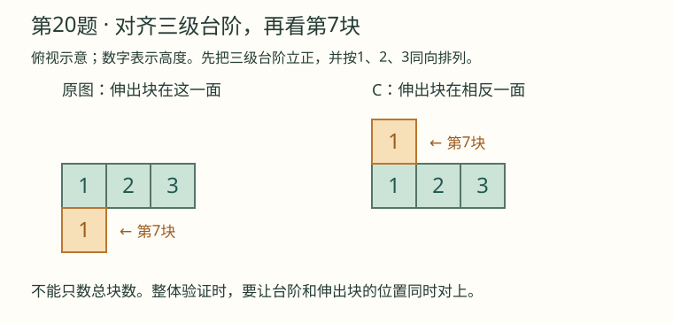
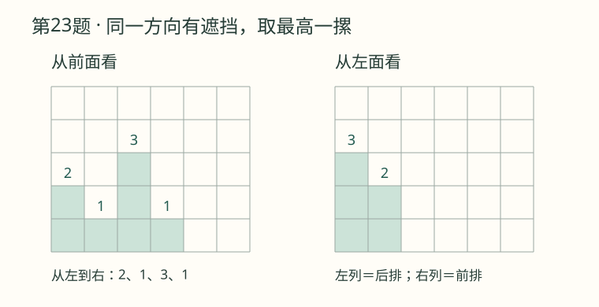
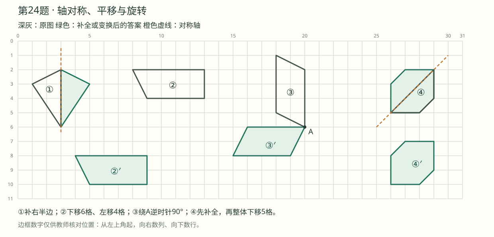

# 第一阶段适应性活动1109：逐题详解与教学方法

本讲义供五年级数学家教备课使用，覆盖原卷全部29题。先独立作答，再用[答案速查](01_答案速查.md)核对。讲解以小数运算、整数乘法运算律、数量关系及图形性质为基础，不需要分数乘除法或列方程。

## 备课总览：方法名称与适用题型

运算定律是依据，拆数、凑整、转化等是选择解法的策略。告诉孩子“怎么想到”，再说明“为什么可以这样算”。下表中的策略归类是结合本卷整理的教学提示，不代表教材中均有同名章节。

| 题目结构 | 建议使用的名称 | 本卷题号 |
| --- | --- | --- |
| 两个乘积有相同因数 | 逆用乘法分配律，提取相同因数 | 3（3）、3（6） |
| 连乘中寻找能凑整的组合 | 拆分因数，运用乘法交换律、结合律 | 3（5） |
| 连续除以两个数 | 除法的性质：除以两个数的积 | 3（4） |
| 两个数同时移动小数点 | 商不变的性质 | 1、2、5、6 |
| 只改变被除数或除数 | 商的变化规律 | 17 |
| 从最终结果倒着找原量 | 逆推法（还原法） | 11、29（2） |
| 按条件逐个试验并排除 | 有序列举（枚举）与筛选 | 10、28 |
| 把折线路径转成两段直线 | 转化思想，线段平移 | 22 |
| 比较不同包装是否合算 | 单价比较（归一法）；统一总价或质量比较 | 27、28 |
| 全部装完、只能装满整箱 | 根据实际情况取商的近似值：进一法、去尾法 | 9、28 |
| 起步价加上超出部分 | 分段计费；不足一个计费单位按一个计算 | 29 |

**术语依据：**《义务教育数学课程标准（2022年版）》列出乘法交换律、结合律、分配律及常见数量关系等内容。本卷优先沿用这些运算依据。[教育部课程标准](https://www.moe.gov.cn/srcsite/A26/s8001/202204/W020220510531636118932.pdf)

“逆推法（还原法）”“枚举与筛选”“凑整”等方法名称，可参照高校《小学数学解题研究》教案；本讲义将它们落实为倒着算、按顺序试、选择方便数字等学生可操作的步骤。[揭阳职业技术学院教案](https://gk.jyc.edu.cn/__local/4/AA/E1/84C928B96C31AF7ABFAE2B3E19E_D5D82A5D_1EA044.pdf)

进一法、去尾法的选择应联系实际情境，不能只记成见到小数就加1或舍去。教学案例也强调让学生解释数量取整的实际意义。[徐汇教师网教学案例](https://tpd.xhedu.sh.cn/cms/app/info/doc/index.php/92078)

## 第1题：口算与混合运算

| 小题 | 结果与思考过程 | 考点及方法 |
| --- | --- | --- |
| 2.5×0.4 | 25×4＝100，再点两位小数，得1 | 小数乘法；整数乘法迁移 |
| 7÷5 | 7÷5＝1.4，可用1.4×5＝7验算 | 除数是整数的小数除法 |
| 1.8÷0.03 | 180÷3＝60 | 商不变的性质，两数同时乘100 |
| 0.56÷0.7 | 5.6÷7＝0.8 | 商不变的性质，两数同时乘10 |
| 1.8×0.05 | 18×5＝90，点三位小数，得0.090＝0.09 | 积的小数位数；积小于原数 |
| 1.2÷0.25 | 120÷25＝4.8；也可想0.25×4＝1，所以1.2÷0.25＝1.2×4 | 转化为整数除法，或根据乘除关系转化 |
| 3.62＋12.8 | 3.62＋12.80＝16.42 | 小数点对齐就是相同数位对齐 |
| 0.23×0.2 | 23×2＝46，点三位小数，得0.046 | 位数不够时在前面补0 |
| 26.3－3.3÷0.3 | 26.3－11＝15.3 | 先除后减 |
| 3.6×2÷3.6×2 | 7.2÷3.6×2＝2×2＝4 | 乘除同级，从左往右计算 |

- **易错点：**把最后一题误读成“3.6×2÷（3.6×2）”；把0.046写成0.46；除数移小数点而被除数不移。
- **家教提问：**“乘号、除号混在一起时谁先算？原题有没有括号？”“1.8乘一个小于1的正小数，结果应比1.8大还是小？”

## 第2题：竖式、小数近似数与循环小数

### （1）4.6×6.7＝30.82

先按整数乘法计算46×67＝3082，两个因数一共有两位小数，积为30.82。

```text
    46
×   67
------
   322
  276
------
  3082
```

- **考点与方法：**小数乘小数；先按整数乘法计算，再确定积的小数点。
- **易错点：**把积点成3.082；第二层部分积没有错位。
- **家教提问：**“4.6×6大约是多少？30.82还是3.082更合理？”

### （2）10.7×0.43≈4.60（保留两位小数）

```text
    107
×    43
-------
    321
   428
-------
   4601
```

准确积为4.601。保留两位小数，看千分位上的1，舍去，得**4.60**。

- **考点与方法：**积的近似数；四舍五入法。
- **易错点：**把4.60写成4.6；前者明确保留到了百分位。准确值用等号，近似值用约等号。
- **家教提问：**“保留两位要看第几位？最后的0为什么要留下？”

### （3）56.588÷2.8≈20.2（精确到十分位）

两数同时乘10，化为565.88÷28。

```text
         20.21
       -------
28 )    565.88
        56
        --
          5 8
          5 6
          ---
            28
            28
            --
             0
```

565除以28，先商20，余5；添下十分位的8，58÷28商2余2；再添下百分位的8，28÷28商1。准确商20.21，保留一位小数看百分位的1，得**20.2**。

- **考点与方法：**商不变的性质；商中间0的占位；求商的近似数。
- **易错点：**漏写个位的0，算成2.021；把“精确到十分位”误当保留两位小数。
- **家教提问：**“除数变28，被除数变多少？5不够除28，个位为什么必须商0？”

### （4）14÷0.9＝15.555…（5循环）

14÷0.9＝140÷9。

```text
         15.555…
       --------
9 )     140.000
          9
         --
          50
          45
          --
           50
           45
           --
            50
            45
            --
             5…
```

整数部分15，余5；以后每次添0得到50，商5余5，所以5不断重复。规范简记时，在15.5中小数部分的5上加一个循环点。

- **考点与方法：**循环小数、循环节；用重复出现的余数判断循环。
- **易错点：**写成有限小数15.55；把整数部分的5也看作循环节。
- **家教提问：**“为什么后面总是商5？哪一个余数在重复？”

## 第3题：怎样简便怎样算

### （1）19.6－9.6×0.5＝14.8

19.6－9.6×0.5  
＝19.6－4.8  
＝**14.8**。

- **考点与方法：**先乘后减；乘0.5可理解为取这个数的一半，9.6的一半是4.8。
- **易错点：**先算19.6－9.6。此题按顺序算已经方便，无需硬套分配律。
- **家教提问：**“0.5个9.6是多少？第一步应算哪一部分？”

### （2）0.78＋0.22÷5＝0.824

0.78＋0.22÷5  
＝0.78＋0.044  
＝**0.824**。

- **考点与方法：**先除后加；除到哪一位，商就写在哪一位；小数加法对齐小数点。
- **易错点：**先凑0.78＋0.22＝1，或把0.22÷5写成0.44。加数和被除数不能随意凑在一起。
- **家教提问：**“虽然0.78和0.22能凑1，但原式允许先加吗？”

### （3）1.23×9.4＋0.77×9.4＝18.8

1.23×9.4＋0.77×9.4  
＝（1.23＋0.77）×9.4  
＝2×9.4  
＝**18.8**。

- **考点与方法：****逆用乘法分配律（提取相同因数）**。先找到两个乘积中相同的9.4，再看另两个因数能否凑整。
- **易错点：**把相同因数9.4也相加；只写1.23＋0.77，漏乘9.4。
- **家教提问：**“1.23个9.4，加上0.77个9.4，一共是几个9.4？”

### （4）2.07÷0.125÷0.8＝20.7

2.07÷0.125÷0.8  
＝2.07÷（0.125×0.8）  
＝2.07÷0.1  
＝**20.7**。

- **考点与方法：****除法的性质**：一个数连续除以两个非0的数，等于除以它们的积。不能称作“除法结合律”。
- **怎么想到：**先观察两个除数，125×8＝1000，所以0.125×0.8＝0.1，合并除数后很好算。
- **易错点：**改成2.07÷（0.125÷0.8）；括号内应是乘法。
- **家教提问：**“12÷3÷2与12÷（3×2）相等吗？能用这个小例子说明规律吗？”

### （5）1.25×32×2.5＝100

1.25×32×2.5  
＝1.25×（8×4）×2.5  
＝（1.25×8）×（4×2.5）  
＝10×10  
＝**100**。

- **考点与方法：****拆分因数，运用乘法交换律、结合律凑整**。
- **怎么想到：**先看1.25需要和8配对，2.5需要和4配对，恰好32＝8×4。由125×8＝1000、25×4＝100，可用已有小数乘法得到1.25×8＝10、2.5×4＝10，完全不需要分数乘除法。
- **易错点：**把32写成8＋4，却仍按连乘处理；拆分前后要保证值相等。
- **家教提问：**“先别看32，1.25和谁相乘方便？2.5呢？32里能不能同时找到这两个因数？”

### （6）20.23×101－20.23＝2023

20.23×101－20.23  
＝20.23×（101－1）  
＝20.23×100  
＝**2023**。

- **考点与方法：****逆用乘法分配律**。把单独的20.23看成20.23×1，两个乘积就有了相同因数。
- **另一条思路：**101＝100＋1，先正用分配律展开，再把多出来的一份20.23减去。此题直接合并101份与1份更短。
- **易错点：**改成20.23×100－20.23，少算了一份；或者把20.23×100写成202.3。
- **家教提问：**“101份20.23减去1份，还剩多少份？”

## 第4题：积的小数位数与商的最高位

**答案：4；十。**

4.09×0.05＝0.2045，有4位小数。409×5＝2045，因数共4位小数，点完小数点得到0.2045。

5.2÷0.13＝520÷13＝40，商的最高位在十位。

- **考点与方法：**积的小数位数；商不变的性质；数位判断。
- **易错点：**机械认为积的小数位数永远等于因数小数位数之和，忽略积末尾0可以化简；本题积末尾非0，恰好是4位。
- **家教提问：**“0.2×0.5＝0.10＝0.1，有几位小数？为什么本题可以直接数成4位？”

## 第5题：由13×28＝364迁移计算

**答案：3.64；36.4；28；2800。**

| 算式 | 推理 |
| --- | --- |
| 1.3×2.8＝3.64 | 两个因数分别缩小到原来的十分之一，积缩小到原来的百分之一 |
| 130×0.28＝36.4 | 一个因数乘10，另一个除以100，积相当于除以10 |
| 3.64÷0.13＝28 | 两数同时乘100，得到364÷13＝28 |
| 3640÷1.3＝2800 | 两数同时乘10，得到36400÷13＝2800 |

- **考点与方法：**积的变化规律；商不变的性质；乘除互逆关系。
- **易错点：**最后一题漏0，写成280；只看小数点移动，不说明两数如何变化。
- **家教提问：**“13×28＝364还能告诉我们哪两个除法算式？”

## 第6题：不必求出精确值得大小比较

**按顺序填：＝、＞、＜、＞、＜。**

| 比较 | 理由 |
| --- | --- |
| 5.67÷0.12＝56.7÷1.2 | 被除数、除数同时乘10，商不变 |
| 0.55÷0.89＞0.999×0.55 | 左边大于0.55，右边小于0.55，以0.55作比较基准 |
| 2.07÷3.1＜1 | 正数相除，被除数小于除数，商小于1 |
| A×0.56＞0.56，所以A＞1 | A×0.56＞1×0.56，同乘正数0.56时，A要大于1 |
| B÷0.42＜0.42，所以B＜1 | 先得B＜0.42×0.42＝0.1764，所以一定小于1 |

- **考点与方法：**商不变的性质；以1或原数为基准比较；积、商与因数、被除数的大小关系。
- **易错点：**“乘数小于1，积就小”应在正数范围使用；最后一空不能只凭“除以小数会变大”而忽略题中整个不等关系。
- **家教提问：**“第二组左右两边各自和0.55相比怎样？不计算能不能分出大小？”

## 第7题：单价×数量＝总价

**答案：145.5元；113.975元。**

48.5×3＝145.5（元）。  
48.5×2.35＝113.975（元）。

第二个精确积有3位小数。原题未要求保留位数，按精确积填113.975；如按人民币“分”结算并四舍五入，才写113.98元。

- **考点与方法：**总价＝单价×数量；小数乘法；精确计算与实际结算的区别。
- **易错点：**自行省略或截去第三位小数，写成113.97；未说明就把近似数当成精确值。
- **家教提问：**“这题有没有提出保留两位小数？如果另外要求按分付钱，该看哪一位？”

## 第8题：求一个数的小数倍与时间换算

**答案：4.8分钟。**

4×0.02＝0.08（小时）。  
0.08×60＝**4.8（分钟）**。

也可先将4小时换成240分钟，再算240×0.02＝4.8分钟。

- **考点与方法：**求一个数的几倍用乘法；1小时＝60分钟；先统一单位。
- **易错点：**把0.08小时写成8分钟；按100而不是60换算。
- **家教提问：**“0.5小时是50分钟吗？为什么小时到分钟要乘60？”

## 第9题：能锯几段与实际余数

**答案：40段，余0.08米。**

4.88÷0.12＝488÷12，整数商为40。  
4.88－0.12×40＝**0.08（米）**。

- **考点与方法：**包含除法；去尾法确定完整段数；用原数据回算余数。
- **易错点：**把488÷12余8直接当成余8米。这里488和12的单位都是厘米，余8厘米＝0.08米；不能锯出第41个完整的0.12米小段。
- **家教提问：**“余数必须比每段长短还是长？0.08＜0.12符合吗？”

## 第10题：由近似商反推整数除数

**答案：最大40，最小39。**

最大的两位数是99。先用99÷40＝2.475找附近的候选，再有顺序地检查：

| 除数 | 商 | 保留一位小数 |
| --- | --- | --- |
| 38 | 2.605263… | 2.6，不合要求 |
| 39 | 2.538461… | 2.5，符合 |
| 40 | 2.475 | 2.5，符合 |
| 41 | 2.414634… | 2.4，不合要求 |

被除数固定为正数99，正整数除数越大，商越小。因此小于38的除数也不会合适，大于41的除数也不会合适，只有39和40符合。

- **考点与方法：**四舍五入的逆向应用；有序列举与筛选；商随除数变化的规律。
- **给教师的范围核对：**保留一位小数为2.5，原商范围是2.45≤原商＜2.55，左端可取、右端不可取。学生不熟悉不等式时，用上表即可。
- **易错点：**只找到40就停止；把原商当作正好2.5，直接算99÷2.5后取整。
- **家教提问：**“商是2.475也能保留成2.5吗？除数再大1，商会怎样变？”

## 第11题：连续用去剩余一半，倒着还原

**答案：43.2米。**

第三次用之前：5.4×2＝10.8（米）。  
第二次用之前：10.8×2＝21.6（米）。  
第一次用之前：21.6×2＝**43.2（米）**。

顺着验算：43.2÷2＝21.6，21.6÷2＝10.8，10.8÷2＝5.4。

- **考点与方法：****逆推法（还原法）**；每次用去一半后，剩下的是当次原有长度的一半。
- **易错点：**把三次“一半”都当作全长的一半；只乘2一次。
- **家教提问：**“现在剩5.4米，第三次剪之前有几个5.4米？再往前呢？”

## 第12题：从残缺竖式找循环小数

**答案：1.2666…，只有6循环。**

两位数除以两位数，除到小数部分时，原被除数已经没有新数字，往后都是添0。

1. 竖式中“10□”必须是100。该步商6，减完余10，所以这一步减去100－10＝90；除数是90÷6＝15。
2. 前一步的“4□”为40，40－15×2＝10，得到同样的余数10。
3. 整数部分商1后余4，所以被除数为15＋4＝19。
4. 整个算式是19÷15＝1.2666…；从商的百分位起，每次都是100÷15商6余10。

```text
          1.2666…
        ---------
15 )     19.0000
         15
         --
          40
          30
          --
          100
           90
          ---
           100
            90
           ---
            10…
```

- **考点与方法：**利用商、除数、余数的关系逆推；用余数重复判断循环节。
- **易错点：**看到已写出的1.26便填1.262626…；循环节不能仅根据已有数字猜。
- **家教提问：**“100减去6个除数后剩10，6个除数是多少？下次添0后又变成多少？”

## 第13题：辨别运算定律

**选B，乘法结合律。**

因为4.4＝0.4×11，  
2.5×4.4＝2.5×（0.4×11）＝（2.5×0.4）×11。

拆开4.4后，先结合2.5与0.4，积为1，计算方便。这是连乘的分组变化。

- **考点与方法：**乘法结合律；把中间因数拆成两个数的积。
- **易错点：**只看到“拆数”就选分配律。拆成乘积与拆成和或差，适用的运算律不同。
- **家教提问：**“拆开后连接0.4和11的是加号还是乘号？”

## 第14题：用面积模型理解部分积

**选B，④⑤⑥。**

5.28＝5＋0.2＋0.08，3.6＝3＋0.6。整个长方形面积是5.28×3.6＝19.008平方分米。

竖式第一层“3168”对应5.28×0.6＝3.168，即①②③；第二层“1584”对应5.28×3＝**15.84**，即下方高3分米的④⑤⑥。

- **考点与方法：**小数乘法算理；乘法分配律；长方形面积；部分积的数位意义。
- **易错点：**把第二层的3看成0.3；把某一个小格④的面积当成整条④⑤⑥的面积。
- **家教提问：**“乘3算的是高3分米的哪一整条？这一条的宽是否仍为5.28分米？”

## 第15题：数轴上的小数乘积

**选A。**

从图可知0＜M＜N＜1。M乘一个小于1的正数N，积小于M，而且仍大于0。在给出的A、B、C、D四个点中，只有A位于0与M之间。

- **考点与方法：**积与因数的大小关系；以0、1为基准判断乘积范围。
- **易错点：**凭图猜出M、N的精确值；没有刻度标值，不能把各点随意当作等分点。
- **家教提问：**“不管M到底是多少，乘0到1之间的N后，会跑到M的哪一侧？”

## 第16题：不计算，比较算式大小

**选A，3.5÷0.5。**

- A：除以0.5，相当于把3.5扩大到2倍。
- B：3.5×1.2，只扩大到1.2倍，结果小于A。
- C：乘0.1，结果小于3.5。
- D：除以1.2，结果小于3.5。

- **考点与方法：**用倍数关系比较；把除以0.5理解为乘2。依据0.5×2＝1即可，不需要分数运算。
- **易错点：**认为“除法算出来一定比乘法小”；只判断A、B大于3.5，却不继续比较2倍与1.2倍。
- **家教提问：**“一个数里包含多少个0.5，是这个数的几倍？”

## 第17题：除数扩大10倍，循环商怎样变化

**选C，0.255255255…，循环节为255。**

原商是2.552552552…，循环节为552。被除数不变，除数的小数点向右移动一位，表示除数扩大到原来的10倍，商相应除以10：

2.552552552…÷10＝**0.255255255…**。

循环小数规范简记时，在0.255中小数部分的第一个2与最后一个5上分别加循环点，对应C。

- **考点与方法：****商的变化规律**；循环小数展开后再移动小数点。
- **易错点：**把商也乘10；把新循环节误写为2552。D表示0.255225522552…，与所得结果不同。
- **家教提问：**“先把原循环小数展开多写几组，再把小数点左移一位，重复的一组到底是哪几个数字？”

## 第18题：油量指针的旋转

**选第二个选项B：顺时针90°。**

指针由左上方的四分之一油量处转到右上方的四分之三处，方向与钟表指针一致，为顺时针。半圆180°均分为4段，每段45°，经过2段，共90°。

- **考点与方法：**旋转的中心、方向、角度；把平角等分后求旋转角度。
- **易错点：**从观察者左右判断旋转方向；把两段误当60°。原卷第四个选项字母重复印为B，应按选项内容核对。
- **家教提问：**“从左边空油到右边满油一共多少度？四分之一到四分之三经过其中几段？”

## 第19题：求商的近似数，哪些说法错误

**选D，错误3个，是②③④。**

| 说法 | 判断与理由 |
| --- | --- |
| ①算到保留数位的后一位再四舍五入 | 正确，是通常求商近似数的方法 |
| ②保留一位小数只看十分位 | 错误，应保留十分位，看百分位决定进舍 |
| ③必须先求出准确商 | 错误，只要算到所需数位的后一位；循环商也无法逐位写完 |
| ④54÷83保留三位小数是0.650 | 错误，54÷83＝0.650602…，第四位小数是6，应该得0.651 |

- **考点与方法：**四舍五入法；保留数位与观察数位的区别。
- **易错点：**只看到前三位650就截断；把“保留几位”误认为“只算几位”。
- **家教提问：**“保留千分位时，需要再算到哪一位？0.650后面的6会让谁加1？”

## 第20题：相同组合体的不同摆放

**选C。**

原组合体可看成“6块组成的三级台阶＋最低一级旁边伸出的1块”，共7块。A、B、D都能通过整体转动与原物体重合；C的伸出块处于镜像一侧，不能只靠转动重合。



图解中先把三级台阶立正，并把高度1、2、3排成同一方向，再比较额外的第7块位于台阶哪一面。课堂上可以用7块积木摆出原物体，整体转向或放倒，对照A、B、D；不要拆开后重摆。

- **考点与方法：**空间想象；整体旋转；比较方块之间的相邻关系。
- **易错点：**只数方块总数，四个选项都可有7块；把左右翻面的镜像误当成转动。
- **家教提问：**“把三级台阶方向对齐后，额外那一块还能同时对上吗？能不能在不拆积木的情况下摆出来？”

## 第21题：判断轴对称图形

**选B，共2个：出站口、出租车图标。**

这里只判断图标本身，不把下方说明文字当作图形的一部分。出站口箭头和框线、出租车的正面图案均可沿中间竖线对折重合。卫生间图案左右为男女不同形象；售票处手持票的图案不对称；问号也不对称。

- **考点与方法：**轴对称图形定义；用对折能否完全重合进行检验。
- **易错点：**只看外框是正方形；因内部局部对称就判整体对称；忽略卫生间左右人物不同。
- **家教提问：**“外框对上了，里面的每一条线也都能对上吗？”

## 第22题：台阶铺地毯的长度

**选C，20 dm。**

台阶地毯的所有水平部分加起来，等于总水平跨度15 dm；所有竖直部分加起来，等于总高度5 dm。

15＋5＝**20（dm）**。

- **考点与方法：****线段平移，化折为直的转化思想**；把各段按水平方向、竖直方向分别合并。
- **易错点：**把地毯长度算成整个外框周长40 dm；把题图未要求覆盖的底边也算进去。
- **家教提问：**“把每一段水平地毯首尾接起来有多长？每一段竖直地毯呢？”

## 第23题：由俯视图确定正面、左面轮廓

原图后排从左到右是2、空、3、1；前排是空、1、2、空。“空”表示这个位置没有正方体。

| 观察方向 | 怎么取高度 | 答案，从左到右 |
| --- | --- | --- |
| 从前面看 | 俯视图每一列沿前后方向取最大高度 | 2、1、3、1 |
| 从左面看 | 俯视图每一排沿左右方向取最大高度；后排画在左，前排画在右 | 3、2 |



- **考点与方法：**从不同方向观察组合体；同一直线上有遮挡，取最高一摞决定该列轮廓。
- **易错点：**把前后两摞高度相加，如把3和2画成5；左面图左右顺序反了；漏掉正面中间高度1的列。
- **家教提问：**“前面2块、后面3块时，从前面能看到总共5块高吗？站到左边，靠前的一排落在视图的哪一边？”

## 第24题：补对称图、平移、绕点旋转



[单独打开方格图，放大核对](24_图形运动.svg)。

### （1）补全轴对称图形①

对称轴是图中竖直线。左侧突出的顶点在轴左2格，把它对应到轴右2格、同一条水平线上，再与轴上两个顶点连接。轴上的顶点位置不变。

- **考点与方法：**对称点到对称轴距离相等；先找关键顶点，再连接。
- **易错点：**左右距离不同；把轴上的点也挪动；数格线条数而不是格子间隔。
- **家教提问：**“这个顶点到轴是几格？它的对称点是不是还在同一行？”

### （2）图形②先向下6格，再向左4格

标出四个顶点，每个点都先下移6格，再左移4格，最后按原顺序连接。移动后上底仍长5格，下底仍长4格，高仍为2格。

- **考点与方法：**平移的方向与距离；对应点移动相同格数，形状和大小不变。
- **易错点：**把“图形之间隔6格”当作下移6格；只移动部分顶点；改变斜边方向。
- **家教提问：**“原来左上顶点与新的左上顶点相隔几行、几列？其他顶点是不是也一样？”

### （3）图形③绕点A逆时针旋转90°

点A保持不动。与A相邻的竖直边原来向上4格，逆时针转90°后，变成从A向左4格。另一个相邻顶点原在A左2格、上1格，转后位于A左1格、下2格。剩下顶点原在A左2格、上5格，转后位于A左5格、下2格。顺次连接四点。

- **考点与方法：**旋转中心、方向、角度；对应线段等长；从与旋转中心相连的边入手。
- **易错点：**把A也移动；旋转成顺时针；只转一条边而其他顶点凭外形猜。
- **家教提问：**“从向上的箭头逆时针转直角，箭头指向哪里？A到顶点的距离变了吗？”

### （4）补全图形④，再向下平移5格

先找斜对称轴上的两个端点，保持不动。原图右侧两处转折顶点分别对应到对称轴左上方，补成完整的六边形。再把完整六边形的全部6个顶点向下平移5格，连接成新图。

- **考点与方法：**斜轴的轴对称作图；对应点连线与轴垂直且两边距离相等；先补全，再平移。
- **易错点：**把斜对称轴当作竖直轴直接左右照搬；只平移题中已有的一半；把斜轴也当作图形边画进答案。
- **家教提问：**“这一题平移的对象是已有的一半，还是已经补好的整个图形？”

### 给教师的方格定位核对

为便于精确核对，下面临时约定：大方格左上角为（0，0），向右数列、向下数行，每格记1。它只是本讲义定位说明，不要求学生学习数对或坐标公式。按下列顺序连接各点，并首尾相连。

| 图形 | 顶点所在（列，行） |
| --- | --- |
| ①原三角形 | （1，3）、（3，2）、（3，6） |
| ①新增对称三角形 | （5，3）、（3，2）、（3，6） |
| ②最终平移图 | （4，8）、（9，8）、（9，10）、（5，10） |
| ③旋转图 | （15，8）、（16，6）、（20，6）、（19，8）；A在（20，6） |
| ④补全后的六边形 | （26，5）、（28，5）、（29，4）、（29，2）、（27，2）、（26，3） |
| ④再向下5格 | （26，10）、（28，10）、（29，9）、（29，7）、（27，7）、（26，8） |

## 第25题：用估算判断是否达到满减门槛

**能参加“满130元减10元”。**

先数清：20.8元的商品**4袋**，牛奶1箱，9.95元的红枣2袋。

为了确定一定能达到130元，把各单价都往小估：20.8＞20，45.8＞45，9.95＞9。

20×4＋45＋9×2＝143（元），143＞130。  
往小估仍超过门槛，所以实际总价一定超过130元，**能参加**。

核对用精确值：20.8×4＋45.8＋9.95×2＝148.90（元），满减后148.90－10＝138.90（元）。原题只要求估算判断，答题时无需额外精算。

- **考点与方法：****估小法（用下界判断）**；先比较优惠前的商品总价与门槛。
- **易错点：**漏数被遮挡的袋子；把20.8估成21、45.8估成46后，只凭“估大后超过130”就断言实际也超过。估计方向必须支持结论。
- **家教提问：**“假如把价格都估低了还超过130，真实价格会怎样？如果都估高了呢？”

## 第26题：先求长，再算周长和面积

**答案：周长202.50米，面积2460.38平方米。**

长：40.5×1.5＝60.75（米）。  
周长：（60.75＋40.5）×2＝202.5（米），保留两位小数写作**202.50米**。  
面积：60.75×40.5＝2460.375（平方米）≈**2460.38平方米**。

- **考点与方法：**求一个数的小数倍；长方形周长与面积；四舍五入。
- **易错点：**把“长是宽的1.5倍”算成宽＋1.5；周长与面积公式混淆；面积未到最后就提前取近似数。
- **家教提问：**“周长是围一圈的长度还是铺满草坪的大小？两个结果各用什么单位？”

## 第27题：比较哪种巧克力便宜

**A种较便宜。**

### 适合本题的简便比较：统一总价

B种2份：18×2＝36（元），0.25×2＝0.50（千克）。  
A种1份：36元，0.55千克。

同样36元，A种买得更多，所以A种每千克更便宜。

### 通用方法：求每千克单价

A种：36÷0.55＝65.4545…（元/千克）。  
B种：18÷0.25＝72（元/千克）。  
前者较低。比较时不必把循环商写完；本题用统一总价更简洁。

- **考点与方法：**单价＝总价÷数量，即归一比较；也可统一总价或数量后比较。
- **易错点：**直接比较36与18就说B便宜；包装质量不同，不能只比每份价格。
- **家教提问：**“如果两种都花36元，分别能拿到多少千克？”

## 第28题：苹果单价、取整与装箱方案

小箱装8千克，售价78元；大箱装12千克，售价104元。0.7吨＝**700千克**。

### （1）大箱每千克售价较低

小箱：78÷8＝9.75（元/千克）。  
大箱：104÷12＝8.666…（元/千克），小于9.75。

也可统一为24千克：3小箱卖234元，2大箱卖208元，同样质量，大箱售价较低。

- **考点与方法：**单价比较；统一质量比较。
- **易错点：**只比较每箱78元与104元；认为大箱每箱贵就一定每千克也贵。
- **家教提问：**“24千克能装几小箱、几大箱？同样质量各卖多少钱？”

### （2）需要59个大箱；可以装满87个小箱

700÷12＝58（箱）……4（千克）。58箱装不完，余下4千克还需1箱，所以需要**59个大箱**。

700÷8＝87（箱）……4（千克）。余下4千克不能再装满一个8千克小箱，所以可装满**87个小箱**。

- **考点与方法：**进一法与去尾法；读清“需要几个容器”和“装满几个容器”。
- **易错点：**两空都四舍五入；把余下4千克当作4箱；先忘记把吨换成千克。
- **家教提问：**“剩下的4千克，在第一个问题里要不要另找箱子？在第二个问题里算不算装满了一箱？”

### （3）86个小箱＋1个大箱，收入6812元

按题目给定的每箱质量装满售卖，并把700千克全部售出。小箱每千克售价更高，应尽量多装小箱，再解决余量。

1. 尽量装小箱：87箱装696千克，剩4千克，不能装满大箱。
2. 少装1个小箱，腾出8千克，与剩下的4千克合成12千克，正好装1个大箱。
3. 质量核对：86×8＋1×12＝688＋12＝700（千克）。
4. 收入：86×78＋104＝6708＋104＝**6812（元）**。

**为什么是装满且全部售完时的最优方案？**0个大箱时，700千克不能全部装进满的小箱；至少需要1个大箱。1个大箱已经可行，又留下尽可能多的苹果放进单价更高的小箱。另外，同样24千克，3小箱比2大箱多卖234－208＝26元，进一步增加大箱不会提高总收入。

| 满箱方案 | 总质量 | 总收入 |
| --- | --- | --- |
| 86小＋1大 | 700千克 | 6812元 |
| 83小＋3大 | 700千克 | 6786元 |
| 80小＋5大 | 700千克 | 6760元 |

- **考点与方法：**有序试装；余量调整；等量替换比较；初步优化思想。
- **易错点：**答87小＋1大，却把最后不足12千克的大箱按满箱价格104元计算；答87小后把4千克苹果漏掉。
- **家教提问：**“87个小箱装完剩4千克，怎样只退回最少的小箱，就能凑满1个大箱？”

## 第29题：代驾分段收费与逆向求路程

收费表中起步费包含8千米；超出的部分每千米3.5元，不足1千米按1千米计；司机免费等候10分钟，超出部分每分钟1元。本题两次预约及开始代驾均处于各自同一收费时段。

### （1）应支付52.5元

20:30对应起步费35元；到达即出发，无等候费。

超出路程：12.2－8＝4.2（千米）。  
按5千米收费：5×3.5＝17.5（元）。  
合计：35＋17.5＝**52.5（元）**。

- **考点与方法：**分段计费；超出部分按整千米进一取值；总费用＝起步费＋超程费＋等候费。
- **易错点：**把全程12.2千米都乘3.5；把4.2四舍五入成4；先把全程四舍五入。
- **家教提问：**“起步费已经买到了哪一段路？超过8千米的4.2千米占了几个收费单位？”

### （2）最远17千米

22:10对应起步费50元；等候12分钟，只有超出10分钟的2分钟收费。

等候费：（12－10）×1＝2（元）。  
超程费：83.5－50－2＝31.5（元）。  
收费的超程千米数：31.5÷3.5＝9（千米）。  
全程最远：8＋9＝**17（千米）**。

收费的9千米是进一后的计费数量。实际超程大于8千米、不超过9千米，因此全程大于16千米、不超过17千米，最大值17千米可以达到。

- **考点与方法：****逆推法与分段计费**；由总费用扣出起步费、等候费，再还原超程数量；理解计费范围。
- **易错点：**把12分钟全算等候费；算出9千米后忘加起步包含的8千米；说路程一定是17千米而忽略“最远”。
- **家教提问：**“83.5元里哪两笔不是超程费？按9千米收费，实际超出8.2千米可不可以？”

## 家教时怎样安排讲解

先让学生独立完成，按真实错题决定先后，不把下面建议视为已完成的课堂进度。

- **先查基础：**第1、2、4、5题，判断小数点、0的占位、近似数是否掌握。
- **再看结构：**第3题，先读运算顺序，再找相同因数或凑整配对，要求说出运算依据。
- **重点辨析：**第10、12、17、19题，训练近似值范围、余数循环与循环节的判断。
- **动手操作：**第20、23、24题，用积木、方格和顶点定位代替凭外形猜。
- **回到情境：**第25、27、28、29题，先解释“要比较什么”“剩下的怎么办”“哪一段收费”，再列算式。

讲解结束时，可以让学生用一句话复述：“这题我先看什么，为什么能这样做，哪里最容易错。”
